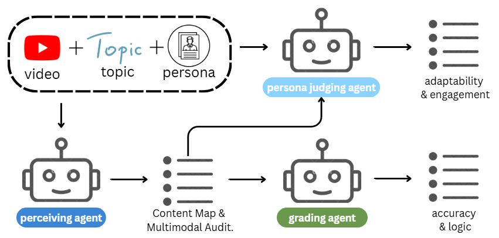

# LLM Judge

The judge that scored every video in the challenge (Layer 1). It watches a teaching video and scores it from 1 to 5 on four dimensions: accuracy, logic, adaptability and engagement.



## How it scores a video

Three Gemini 3 Flash agents run in order.

| Agent | Prompt | What it does |
| --- | --- | --- |
| 1. Content analyst | `prompts/agent1_prompt.md` | Watches the video, writes a timestamped outline and lists possible problems |
| 2. Judge | `prompts/agent2_prompt.md` | Checks the listed problems and sets the **accuracy** and **logic** scores |
| 3. Simulated student | `prompts/subjective_prompt.md` | Watches the video as the student described in the persona and sets the **adaptability** and **engagement** scores |

Each dimension starts at 4. It loses points for each problem found, gains a small bonus for strengths, and is kept between 1 and 5. `examples/` holds two complete outputs.

## Setup

```bash
pip install -r requirements.txt
export GEMINI_API_KEY="your key"
```

`ffmpeg` must be installed, because videos are fetched with `yt-dlp`.

## Run

Score the challenge videos, using the `judge_input.json` written by `prepare_inputs.py` at the repository root:

```bash
INPUT_FILE=../inputs/judge_input.json python batch_audit_processor.py
```

Without `INPUT_FILE`, it scores the four videos in `example_input.json`.

Results go to `eval_results/concurrent_<time>/`: one JSON file per video, in the same format as `examples/`, and a `*_summary.csv` with the four scores of every video.

### Settings

| Environment variable | Default | Meaning |
| --- | --- | --- |
| `INPUT_FILE` | `example_input.json` | Videos to score |
| `MAX_CONCURRENT` | `3` | Videos scored in parallel |
| `NUM_RUNS` | `1` | How many times to score each video, for checking consistency |
| `VIBE_TEACH_GEMINI_SEED` | `42` | Generation seed; set to `none` to let the API choose |

### Input format

```json
{
  "videos": [
    {
      "video_url": "https://.../video.mp4",
      "course_requirement": "Big Concept: ... Topic: ... Learning Goal: ...",
      "student_persona": "Grade: 9th grade | Focus Time: 15 minutes | Background Knowledge: ..."
    }
  ]
}
```

A video can also carry a list `personas` instead of a single `student_persona`, to be scored once for each persona.

## Web service

`server.py` offers the same scoring over HTTP:

```bash
uvicorn server:app
```
